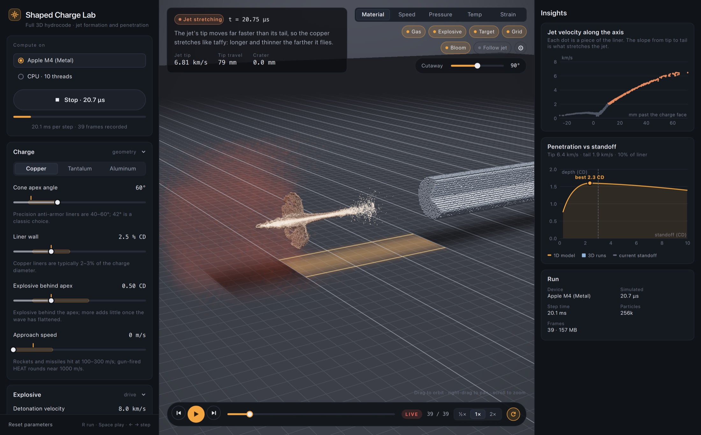

# Shaped Charge Lab

A native, GPU-accelerated 3D simulation of shaped-charge jets, for understanding how they form and why
there is an optimal standoff distance between the charge and its target.

An explosive drives a conical metal liner inward. It collapses on the axis into a fast, stretching jet
and a slow slug. The jet stretches, breaks into particles, and penetrates the target. Every stage is computed by a
full 3D SPH hydrocode (no symmetry assumed) and rendered in 3D.



> Status: work in progress. The simulation runs on CPU, Apple Metal and AMD GPUs (HIP); NVIDIA (CUDA) is written but
> untested. The app runs on macOS; Windows and Linux builds and installers are next. Penetration depth is not yet
> converged with resolution; see [docs/convergence.md](docs/convergence.md).

## The app

- Live 3D view of the full simulation: a cutaway that always faces you, glowing explosive gas, metal shading, and a
  ground grid in charge diameters with the standoff gap highlighted. Colour by material, speed, pressure,
  temperature or plastic strain.
- Every run records as it goes: scrub or play back any moment while it is still running.
- Every parameter shows its realistic band and value from real hardware; click the tick to snap to it.
- An explainer says what is happening in each phase, next to the jet's velocity profile and the penetration-versus-
  standoff curve computed from the jet the charge actually formed.
- Pick the GPU or the CPU (and its thread count) to run on.

## Physics

- Smoothed-particle hydrodynamics, cubic-spline kernel, Monaghan artificial viscosity and artificial stress.
- Metals (copper, tantalum, aluminum liners; armor steel and aluminum targets): Mie–Grüneisen equation of state,
  J2 plasticity with Johnson–Cook-style hardening and thermal softening.
- Failure: Tuler–Butcher cumulative spall damage, ductile failure on tensile plastic strain (jet breakup).
- Explosive: generic γ-law products with programmed burn, set by detonation velocity.
- Adaptive refinement: each liner particle tracks its deformation gradient and splits along its principal stretch
  when the material it represents has stretched to twice its length (mass and momentum conserved).
- A 1D modified-Bernoulli model applied to the measured jet gives penetration versus standoff.

Details: [ARCHITECTURE.md](ARCHITECTURE.md).

## Backends

The physics is written once (`core/src/physics/sph.h`) and compiled for every backend:

| Backend | Hardware | Status |
|---|---|---|
| CPU | any x86-64 / ARM64, multithreaded | working (macOS, Windows) |
| Metal | Apple Silicon | working |
| HIP | AMD (ROCm on Linux, HIP SDK on Windows) | working (RX 6700 XT, ~2.9× an M4 GPU) |
| CUDA | NVIDIA | written, untested |

## Build

Requires CMake ≥ 3.25, a C++20 compiler and Qt ≥ 6.7 (Quick, QuickControls2, ShaderTools).

```bash
cmake -S . -B build -DCMAKE_BUILD_TYPE=Release
cmake --build build -j
open "build/app/Shaped Charge Lab.app"   # macOS; on Windows/Linux run build/app/Shaped Charge Lab
./build/core/scl_smoke 20               # 20-second benchmark run, no UI
```

The app takes `--run` (start immediately), `--quit-after <s>` and `--screenshot <file>` for automated smoke tests.

- **macOS**: Xcode command line tools. The Metal backend is built automatically.
- **Windows**: MSVC or MinGW-w64. For AMD GPUs, install the AMD HIP SDK. For NVIDIA GPUs, install the CUDA toolkit.
  CMake picks HIP, then CUDA, then falls back to CPU only. See [docs/environment.md](docs/environment.md).
- **Linux**: GCC or Clang. Install ROCm (AMD) or the CUDA toolkit (NVIDIA) for the GPU backend.

`scl_smoke [seconds] [layers] [auto|cpu|metal|hip] [cpu threads]` runs the default charge and prints progress.
Set `SCL_PROFILE=1` for per-phase CPU timings.

## Layout

- `core/`: simulation library behind `core/include/scl/api.hpp`
- `app/`: Qt 6 Quick app (QML UI, QRhi renderer: Metal / Direct3D / Vulkan from one code path)
- `ShapedChargeLab/`: original SwiftUI/Metal prototype (reference)
- `docs/`: convergence study and build-machine setup

## License

MIT, see [LICENSE](LICENSE).
